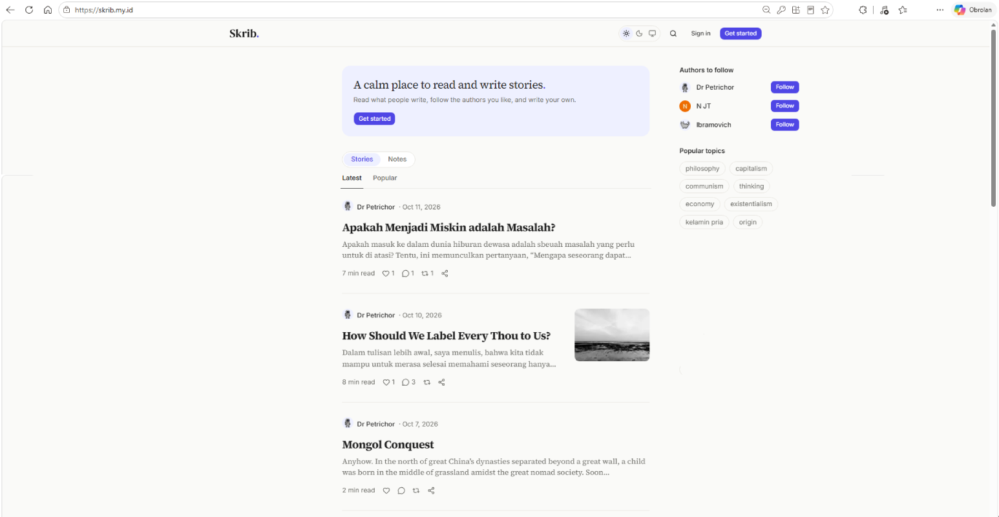
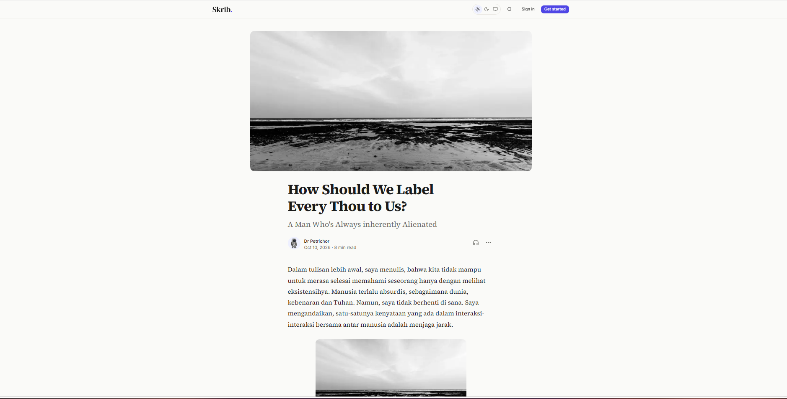
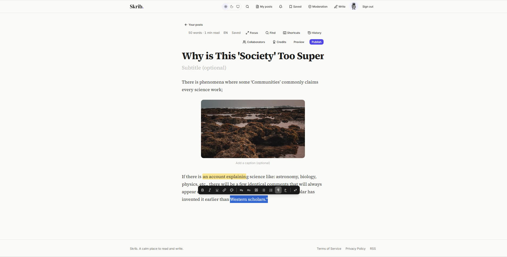
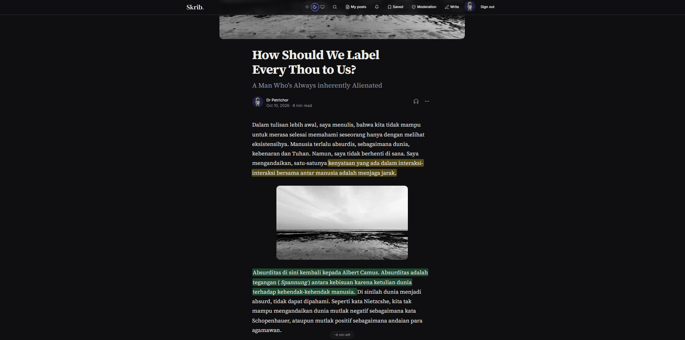

# Skrib.

**A calm place to read and write.** Skrib is a multi-author blogging platform with a wide, comfortable reading design, a Medium-style editor, and a social layer on top: follows, likes, comments, notes, and notifications.

**Live:** [skrib.my.id](https://skrib.my.id)



---

## Screenshots

| Article | Editor |
|---|---|
|  |  |

**Dark mode**



---

## Highlights

**Writing**
- Medium-style Tiptap editor: bubble toolbar, "+" menu, footnotes, text colors and highlights, `@mentions`, images with crop before upload.
- Autosave, version history with restore, find and replace, focus mode with typewriter scroll, publish checklist.
- Co-authoring with a turn-based edit lock ("one pen"), plus an editor role that can send a draft back with a note.
- Scheduled publishing, series, topics, and a pinned story on the profile.

**Reading**
- Reading menu (text size, column width, serif or sans, sepia), progress mark on cards, and "continue where you left off".
- Private highlights with notes, share-as-card, image lightbox, footnote side panel, listen with the browser voice.
- Saved stories that open offline (installable PWA with a small service worker).

**Community**
- Follow, like, comment (with quoted passages), repost, and short public **Notes** with threads and reply policies.
- Latest, Popular, For you (ranked from your own likes, saves, reads and follows, no AI), and Following feeds.
- Full-text search with snippets and "Did you mean", RSS per site, author, and topic.
- Block and mute (Notes), reports, and an admin moderation area with notices, timed suspension, and mail.
- Email newsletter per author and author insights (views and reads, counts only, no cookies).

## Tech stack

| Concern | Choice |
|---|---|
| Framework | Next.js 16 (App Router, Server Components and Actions), React 19, TypeScript (strict) |
| Styling and UI | Tailwind CSS v4, shadcn/ui (`base-nova`, built on Base UI), lucide-react |
| Database and auth | Supabase Postgres with Row Level Security, Supabase Auth (Google and email) |
| Editor | Tiptap v3 (the reader renders with `@tiptap/static-renderer`, no editor JavaScript) |
| Images | Cloudinary (signed uploads) |
| Validation | Zod 4 |
| Email | Brevo (SMTP for auth mail, REST API for moderation and newsletter mail) |
| Errors | Sentry (errors only, privacy-first settings) |
| Hosting | Vercel |

## Architecture

The one rule that shapes the codebase: **function is separate from UI**.

```text
src/
├── app/        routing only, thin pages that assemble features and UI
├── features/   the brain: queries, Server Actions, validation, per feature
├── ui/         the face: pure components, props in and JSX out
└── lib/        shared tools (Supabase clients, constants, helpers)
```

- `ui/` may not import `features/`, Supabase, or Server Actions. ESLint enforces it with `no-restricted-imports`.
- Security lives in the database: RLS on every table, column-level grants, restrictive policies for suspended accounts, and `security definer` functions kept in a private schema.
- Abuse protection is built in: per-user rate limits in Postgres, strict input limits in the app, Zod, and CHECK constraints, and a report flow.
- Schema changes are numbered SQL files in `supabase/migrations/` (100+ so far).

## Run it locally

You need Node.js, a Supabase project, and a Cloudinary account.

```bash
git clone https://github.com/fathun12/skrib-showcase.git
cd skrib-showcase
npm install
```

Create `.env.local` (names only here, never commit real values):

```bash
NEXT_PUBLIC_SUPABASE_URL=
NEXT_PUBLIC_SUPABASE_PUBLISHABLE_KEY=
SUPABASE_SERVICE_ROLE_KEY=        # server only
NEXT_PUBLIC_CLOUDINARY_CLOUD_NAME=
CLOUDINARY_API_KEY=
CLOUDINARY_API_SECRET=            # server only
NEXT_PUBLIC_SITE_URL=http://localhost:3000
```

Optional: `NEXT_PUBLIC_SENTRY_DSN`, `BREVO_API_KEY`, `BREVO_SENDER_EMAIL`, `BREVO_SENDER_NAME`, `CRON_SECRET`.

Apply the files in `supabase/migrations/` in order (SQL Editor, one by one), then:

```bash
npm run dev
```

Useful checks:

```bash
npx tsc --noEmit
npm run lint
```

## Design principles

1. **Reading comfort** first: typography, spacing, contrast.
2. **Elegance and simplicity** of the interface.
3. **Efficiency**: small bundles, server-rendered articles, fast pages.
4. **Easy to restyle**: design tokens as CSS variables, light and dark themes.

## License

Released under the [PolyForm Noncommercial License 1.0.0](LICENSE). The source is open to read, learn from, and use for any noncommercial purpose. Commercial use needs written permission from the author: [hello@skrib.my.id](mailto:hello@skrib.my.id).

## Contact

[hello@skrib.my.id](mailto:hello@skrib.my.id)